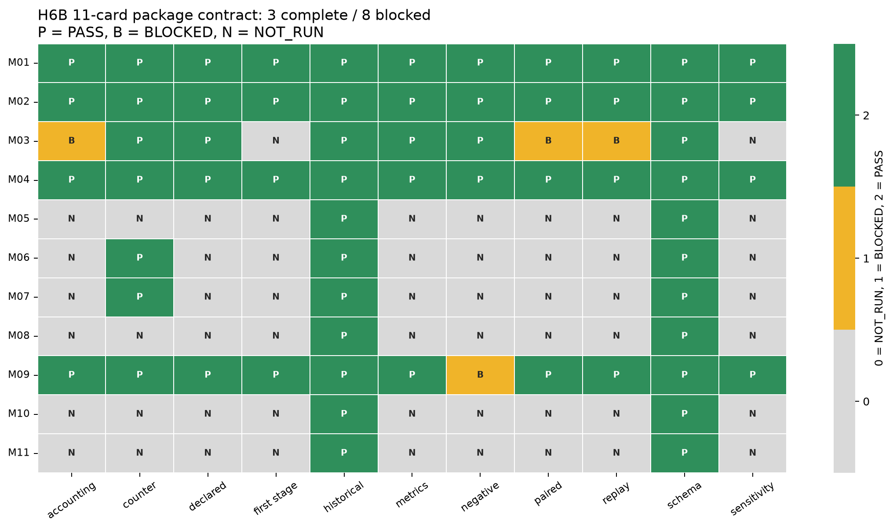
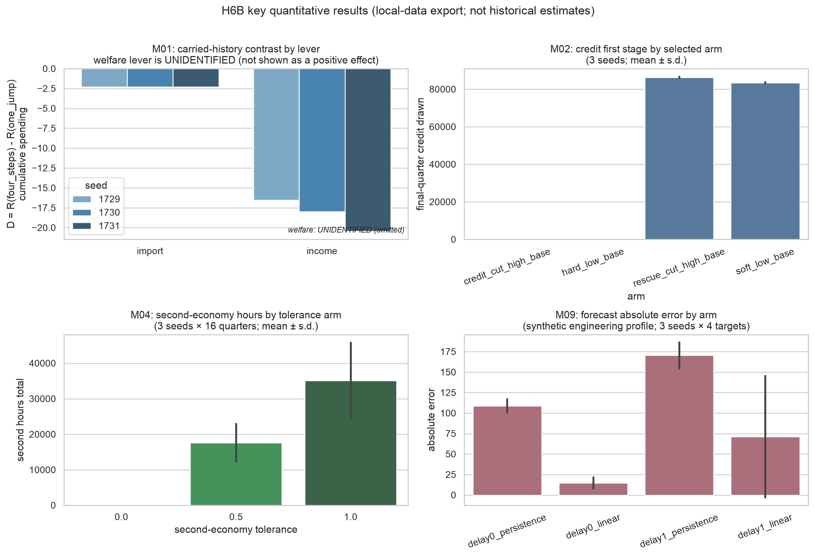

# 匈牙利社会主义机制实验室

**Hungary Socialist Mechanism Lab / `hsm-lab`**

一个研究匈牙利 **1957Q1—1985Q4** 经济与制度机制的季度模拟实验室。项目把生产、投入品、流通、家庭消费、信用、财政、信息与政治反馈放入同一个有账目约束的模型，并在独立的政治模型中实现政策与信息机制，考察：**在明确写出的结构假设下，这套模型能否重现已有历史统计的变化方向？出现偏差时，偏差发生在哪一条机制路径？**

当前仓库的权威研究包是 **HIST_VNEXT H6B**。它不声称“11 张机制卡都通过”，而是给出一次严格验收：**3 张卡 `complete`，8 张卡 `blocked`；没有任何历史 `SUPPORTED` 声明。** 早期 P06 的历史复现失败及原因定位仍保留在阶段记录中；H6B 的进展是建立了可审计、可冷启动重放的 11 卡研究包，而不是把历史识别问题改写成成功。

> this study establishes no calibrated or validated historical estimate; it establishes a reproduction failure and its located causes.
>
> 模拟结果用于提出和检查论证；模型中的概率不等于历史事件的真实概率。

## 1. 项目背景

本项目关注社会主义经济中的几个相互联系的问题：企业需要投入品才能生产，生产出的商品需要通过批发、零售和运输才能到达家庭；工资、信用、财政转移与企业的软预算约束决定谁能够支付；家庭还面临消费品、耐用品和住房的不同限制。改革、外部冲击与信息传递可能改变这些关系，但不能把一个历史事件直接转换成任意的“支持度增加”或“产量提高”。

匈牙利的研究时段包含 1968 年经济改革、1973 年外部冲击等研究节点。项目用这些节点组织反事实实验，并把物量与货币的流转写成可检查的规则。研究目的不是预先证明某一种制度理论，而是允许规则被证据否定，也允许结论是“当前结构不能复现”。

P06 阶段得到了一项明确的**历史复现失败及原因定位**：消费指数在模型中下降、在观测中上升；进口通道可以传递声明的需求，出口通道受到 Treasury 支付现金约束。H6B 在此之后没有重新做历史校准，而是把 M01—M11 的现有实验和可核阻断封成一个严格研究包，逐卡检查配对、首阶段、账本、负对照、metrics 与 replay。基础研究约定见 [BASELINE.md](BASELINE.md)；阶段实现、实验和审查记录保留在 [docs/phases/](docs/phases/)。

## 2. 研究目标与实际范围

项目有三类目标：

1. **机制可执行**：把物量、金融、家庭行为以及政治反馈写成能运行、能检查、能反事实分叉的规则。
2. **数据可追溯**：每个输入声明来源、权限、角色、单位、时间窗口和文件 hash，区分观测、重构和结构假设。
3. **结果可证伪、可复现**：使用预先声明的指标和容差，保留失败、无效杠杆及未识别状态，并通过固定 seed、参数 hash 和 replay digest 复跑。

当前 scope 是 **research-package audit（研究包验收）**：H6B 不重新估计历史参数，也不把“实验完整”混同于“历史成立”。`calibrated = 0` 仍是当前结果；参数注册中有 9 项结构固定规则和 6 个未识别行为块。“固定”指运行时声明或设计固定，并不意味着从历史数据估计出来。

时间窗口严格区分：

| 窗口 | 用途与边界 |
|---|---|
| 1957Q1—1985Q4 | 运行时段，116 个季度；所有正式运行止于 1985Q4 或之前 |
| 1960—1969 | 已准入目标的比较窗口；配置名称为 calibration，但本研究未进行参数校准 |
| 1970—1978 | 第二个已准入比较窗口；配置名称为 internal_validation，但不构成模型获验证的声明 |
| hold-out | 不用于选择情景、参数、容差或判定 |
| 1986Q1—1988Q4 | 保留窗口，保持关闭 |

## 3. 方法：模型怎样工作

### 3.1 物量、金融与家庭

模型按季度更新。组织通过稀疏生产网络采购投入品、组织生产、运输和分销。金融路径检查可支付资金、信用与财政转移；家庭路径区分希望购买、能够负担和最终买到的数量，记录预算短缺、可得性短缺、排队、储蓄、耐用品和住房存量。

每季度检查物量与货币账目：期初存量、生产和流入，必须能与使用、流出、损耗和期末存量对应。**账目守恒通过只能说明核算一致，不能说明模型符合历史。** 新的会计残差不能因为实验结果看起来更好而被接受。

项目包含两种不能直接混比的模型配置：

| 配置 | 内容 | 解释边界 |
|---|---|---|
| F1 / `intermediate8_v1` | 八类商品的机制模型，承载 P04 政治与政策分叉实验 | 用于声明假设下的机制反应；其生产、消费总量不能直接与 F2 总量比较 |
| F2 / `f2_v1` | 十六类商品的历史复现物质经济模型 | 更细商品结构仍是模型单位和结构假设，不自动成为历史吨数、HUF 或 GDP |

F2 包含燃料、电力、金属材料、化工、机器资本、建设、农业原料、食品、纺织、家庭消费品、车辆及服务等商品组。商品组产量加总不能冒充 GDP；资本品生产不能冒充投资；一个农业原料组也不能冒充小麦、玉米和谷物的独立序列。

### 3.2 政治、信息与反事实

P04 提供联盟、政策协调、报告与观测、技术信息能力、文化和反对行动等模块。它们通过声明的渠道作用于模型，没有“事件发生就直接加一个结果分数”的捷径。反事实从同一 checkpoint 分叉，记录父运行、干预、参数和 replay digest。

这些政治行为系数没有得到独立历史观测的约束。P06 的 1968、1973 和政治反事实反映的是**在既定规则下模型如何响应**，不能据此声称识别了真实历史中的政治因果效应。部分政治杠杆在全部报告指标上与控制组一致，尽管运行 digest 不同；这些无效杠杆被明确保留在报告中。

### 3.3 数据角色与比较方法

数据注册将文件区分为外生输入、初始状态、潜在参数、目标和政策输入。KSH 产出、消费及贸易统计是 **TARGETS：只用于比较，不能倒灌为运行需求或初始化状态**。观测资料、重构值、文献代理和合成 fixture 分开标注。

P06 的 crosswalk 覆盖 14 个已准入变量。指数比较把模型各年的量归一到模型自己的 `1960 = 100`，而不是把模型调到观测的水平。1960 年相等是归一化定义的结果，因此标记为“不提供信息”；真正的比较是余下 18 年。容差固定为 **0.5 个指数点**，不根据结果调整。

H6B 不新增历史测量，只读取既有实验、阻断证书、研究声明和已登记运行。`evidence_index.json` 只允许定位 root 内的 existing/fresh/repeat 目录，不接受 check 布尔值、Python 表达式、待执行 shell 或任意原件路径。受限/target/HOLD/reserved/private 路径在 open/hash 之前拒绝。

### 3.4 实验与敏感性

项目使用结构审计、单因素扰动（OAT）、Morris 筛选、固定 seed 的重复运行、checkpoint 分叉、账目检查和确定性 bundle 重建。Morris 用来找出声明输入中哪些影响模型，不估计历史参数。未识别参数不做 Sobol 分析；正式历史研究未运行 ABC/pyABC 推断。代码中保留的校准接口和合成 API smoke 不代表历史校准已经发生。

H6B 对每张卡固定检查 11 项：

`schema_valid`、`experiment_declared`、`paired_control`、`first_stage_checked`、`accounting_checked`、`negative_control`、`metrics_generated`、`sensitivity_or_reason_not_run`、`historical_evidence_grade`、`counterevidence`、`reproduction_bundle`。

`research_package_complete` 只在 11 项全部 `PASS` 时为真。历史 `UNIDENTIFIED` 本身不降低实验完整性；缺 paired、first-stage、账本、负对照、必需 metrics 或 replay 才会阻断 complete。

## 4. 主要结果

### 4.1 首要结果：11 卡严格验收，3 complete / 8 blocked

H6B 的当前结果为：

| 指标 | 结果 |
|---|---:|
| 机制卡 | 11 |
| `research_package_complete` | **3**（M01, M02, M04） |
| `blocked` | **8**（M03, M05, M06, M07, M08, M09, M10, M11） |
| 旧卡声明指标保留 | **41**（14 mapped / 27 blocked） |
| 历史 `SUPPORTED` | **0** |
| 已准入独立历史序列 | **0** |



`P = PASS`、`B = BLOCKED`、`N = NOT_RUN`。每一张卡都独立计算 11 项合同；完整不等于历史成立，blocked 也不等于“失败后被隐藏”。

| 卡 | 包状态 | 技术 | 结构 | 历史 | 阻断项 |
|---|---|---|---|---|---|
| M01 | **complete** | PASS | import/income = 条件性 carried-reference 效应；welfare = UNIDENTIFIED | UNIDENTIFIED | 无 |
| M02 | **complete** | PASS | 证伪条件在合成窗口内满足 | UNIDENTIFIED | 无 |
| M03 | blocked | PASS | PASS_SYNTHETIC | UNIDENTIFIED | paired、first-stage、会计、敏感性、replay |
| M04 | **complete** | PASS | 容量上限下首阶段成立 | UNIDENTIFIED | 无 |
| M05 | blocked | NOT_RUN | NOT_RUN | UNIDENTIFIED | 无专用实验，NOT_STARTED |
| M06 | blocked | BLOCKED | NOT_RUN | UNIDENTIFIED | 缺外部债务合同准入 |
| M07 | blocked | BLOCKED | NOT_RUN | UNIDENTIFIED | 缺地区 crosswalk |
| M08 | blocked | NOT_RUN | NOT_RUN | UNIDENTIFIED | 无专用实验，NOT_STARTED |
| M09 | blocked | PASS | SYNTHETIC_ENGINEERING_PROFILE | NOT_RUN | 仅有 `negative_control` 阻断 |
| M10 | blocked | NOT_RUN | NOT_RUN | UNIDENTIFIED | 无专用实验，NOT_STARTED |
| M11 | blocked | NOT_RUN | NOT_RUN | UNIDENTIFIED | 无专用实验，NOT_STARTED |

### 4.2 三张 complete 的定量结果与其余阻断



- **M01（左上）**：同一冻结状态下，长历史 `four_steps` 相对 `one_jump` 的累计支出差在不同 lever 上为负；import 与 income 的 carried-reference 效应方向稳定，但幅度和解释都受合成 history 限制。welfare lever 为 `UNIDENTIFIED`，没有被画成正效应。78/78 arms、3 seeds × 26 arms、每 seed 一个匹配 opening digest；reference/cut first stage 均 PASS；每 arm 8 ticks，material/finance tolerance ratio ≤ 1；0.1 vs 0.0 formation-ratchet ablation 执行；fresh/repeat 全研究复现既有 study digest。
- **M02（右上）**：`credit_cut_high_base` 与 `hard_low_base` 的期末信用抽取为 0；`soft_low_base` / `rescue_cut_high_base` 为非零。这是预算/信用 first stage 的可执行证据，不是历史估计。3 seeds × 13 arms × 4Q = 156 ticks；每 seed 一个共享 opening state；156/156 ticks 守恒、2,616,002 条 journal legs、0 invalid；placebo 在三个 seed 的 comparison/scientific/final-state/journal digest 全部相等；卡自身证伪条件满足，`SUPPORTED` 明确不可达。
- **M04（左下）**：second-economy hours 随 tolerance 0.0 → 0.5 → 1.0 单调上升；0.0 arm 为真实零对照。3 seeds × 3 tolerance arms × 16Q = 144 arm-ticks；每 seed 共享 opening pool；全臂触达 10 activities/worker 容量上限；F2 pool/input 残差 ≤ 1e-9；fresh/repeat 的 `study.json` 字节一致。
- **M09（右下）**：`delay0_linear` 的合成预测绝对误差最低；action channel 饱和，因此经济结果在 seed 内相同。这是工程 profile，不是历史预测能力。M09 有完整的 3×4×4 合成配对矩阵、信息 first stage、逐 tick 物量/金融 gate 和 fresh/repeat replay，但没有专用预注册负对照臂或封存负对照指标，因此仅因 `negative_control` 阻断。

M03 是 opt-in 劳动制度的实现证据，不是 paired 实验：没有 per-seed 处理/对照矩阵、per-tick 账本汇总、政策 first stage 或预注册敏感性。N1–N3 执行并通过，但不足以上升为完整研究包。M05/M08/M10/M11 没有专用实验目录；声明和 H0B/H6A 前置缺口被保留，状态是 `NOT_STARTED`，不是 placeholder-complete。M06/M07 是 blocker-only 封存包；外部债务合同、地区 crosswalk 缺失不会被“封存 PASS”伪装成研究完成。

### 4.3 证据覆盖与历史识别

41 项旧卡声明指标全部保留，保持 `(card, index, verbatim string)` 粒度；其中 14 项 mapped、27 项 blocked。H6B 没有把旧指标改写成新的“已测”字段，也没有把 study-level 替代指标冒充原字符串已覆盖。

历史侧仍是：**0 个 `SUPPORTED`，0 条 admitted independent historical series，15 条 reference-only source metadata。** `source_rights` 只记录 source id、rights status、admission status 与共源关系，不复制 `local_path`、原文、OCR 或译文；`redistribution_allowed_any = false`。因此公开导出不含受限原件，也不因 GitHub 可访问而升级第三方数据的再分发权。

P06 的历史比较结果仍然有效：14 个已准入变量中 2 个可映射为归一化指数、1 个 blocked、11 个 no_counterpart；消费与进口各 18/18 有信息年份超出容差。这些结果没有被 H6B 的“实验包完整”覆盖或撤销。

### 4.4 机制判定、冻结门与工程检查

M01、M02、M04 为 `complete`，但它们的历史判定均为 `UNIDENTIFIED`；M09 为 `SYNTHETIC_ENGINEERING_PROFILE` / `NOT_RUN`。M03 是 `PASS_SYNTHETIC` 的实现证据，制度归因仍为 `UNIDENTIFIED`。**没有 `SUPPORTED`，这是研究结果。** 已观测到某种模型敏感性，不等于相应历史机制已成立。

H6B 最终工程检查：

| 检查 | 结果 |
|---|---|
| 全量测试 | **1902 passed, 180 warnings** |
| ruff | All checks passed |
| `uv lock --check --offline` | Resolved 101 packages |
| `hsm baseline verify --json` | status ok，SHA-256 `1f5b233f…` |
| C0 `historical_f2_replay` | 116 ticks，digest `92f9ea0a…` |
| C1 `historical_f2_trade_scenario` | 116 ticks，digest `c4810481…` |
| C0/C1 reproducibility bundle | `status=verified`、`digest_matches=true`、`parameter_hash_matches=true` |
| 导出确定性 | 同模式重复与 cold `git archive` 重建均字节一致 |
| 导出校验 | git-only `2216c9f1…`，local-data `f4032201…`，`verify` exit 0 |

三轮独立复核结果为 **PATCH → PATCH → PASS**；最终 PASS 只批准证据封存与本地提交，不批准历史推断、不改变 `calibrated = 0`。

## 5. 结论：这项研究说明了什么

可以确认的是：当前规则能形成可审计、可重放的模拟；H6B 的 11 卡严格验收包可以冷启动重建，3 张卡在 paired/first-stage/账本/负对照/metrics/replay 上达到 complete；M02 的证伪条件在合成窗口内满足；M04 的首阶段在容量上限下成立；M01 的 carried-reference 对比是条件性结构结果；M09 的合成预测误差可计算但经济传导为有效 null。

不能确认的是：历史上的联盟偏好、文化认同、报告激励、反对行动能力或对外政策系数已经被估计；某个改革反事实是实际历史会发生的结果；任何机制卡已经得到充分支持；H6B 的 complete 等于历史 `SUPPORTED`。当前 8 张 blocked 卡中，M03 缺 paired/账本/首阶段/敏感性，M05/M08/M10/M11 未启动，M06/M07 缺外部前置，M09 缺专用负对照；这些阻断都是结果的一部分。

要改变研究结论，需要独立可准入的观测和参数—观测 linkage，需要解决消费规模/结构与出口支付路径问题，再以原有边界和明示规则重新比较。单纯调高信用、换容差、填造产品拆分，或把 blocker-seal PASS 当成研究 PASS，都不能解决这些证据问题。

## 6. 局限

- **结构与单位**：组织配置、投入系数、管理价格、家庭分组和多项行为规则是声明假设；模型单位不能直接当作历史单位。
- **可识别性**：六个行为块缺少独立约束，并存在观测噪声乘积、偏差比例与政策输入的跨块混淆；宏观结果不足以把它们分开。
- **比较覆盖**：14 个已准入变量只有两个可映射，一个被阻断，11 个无对应量；增加一个表格栏目并不增加它的实证解释能力。
- **数据缺口**：`wage`、`cpi`、`trade`、`debt`、`housing`、`retail`、`employment` 七个 target-role 变量仍未准入；物理投入流、计划—报告—核实链条、独立重复测量、干部/组织、文化接触和反对行动资料仍是获取候选。
- **研究包边界**：H6B 的 complete 只表示 11 项合同通过；它不自动传播到其他卡、不把 M09 的合成 profile 当预测能力、不把 M03 的实现证据当制度归因、不把 M06/M07 的阻断封存当研究完成。
- **环境与外推**：正式实验只在 Mac 上检查；不宣称 Linux、Windows、其他历史时期或保留窗口中的结论。参数固定 seed 的重复运行不是后验不确定性。
- **资料权限与发布范围**：Git 中提供代码、配置、注册 manifest、报告和合成 fixtures；`data/raw/`、`data/observed/`、私有资料、运行 Parquet/DuckDB 和 `outputs/` 不随 push 分发。第三方资料是否可读、使用或再分发，以各来源注册权限为准；GitHub 仓库可访问不自动授予第三方数据再分发权。

## 7. 安装与复现

### 7.1 环境

从仓库根目录运行。需要 **macOS、Python 3.12、uv**；正式运行遵守 Mac-only 边界。依赖由 `uv.lock` 固定。

```bash
git clone https://github.com/swjn2017USTC/hungary-socialist-mechanism-lab.git
cd hungary-socialist-mechanism-lab
uv sync --locked
uv run hsm --help
uv run hsm baseline verify --json
```

若仓库保持私有，clone 需要相应 GitHub 访问权限。`uv sync` 创建本项目 `.venv`；不要只从另一个环境调用 pytest，因为 clearance/证据测试还会调用本地工具。

### 7.2 检查代码与合成 fixtures

```bash
uv run ruff check src tests
uv run python -m pytest -q -p no:cacheprovider
```

当前发布前检查：完整研究工作区 **1902 passed, 180 warnings**；ruff 通过；`uv lock --check --offline` 与 `hsm baseline verify --json` 通过。新 clone 没有 `outputs/`，因此 local-data 的 H6B 审计会明确显示 replay/run 相关检查 blocked，而不是自动填 PASS；git-only 审计不读取 ignored outputs，可用于验证 11 卡身份和合同结构。

### 7.3 复现核心 C0/C1 运行

这两个场景使用已提交的合成 fixtures，不需要把受限 KSH 数据复制进仓库。seed、组织、家庭和参数保持场景声明；以下命令不给它们作临时覆盖。**输出目录必须不存在**；若已运行过，选一个新目录，程序会拒绝自动覆盖。

```bash
uv run hsm run --scenario historical_f2_replay \
  --until 1985Q4 --output-dir outputs/reproduce/C0 --json

uv run hsm run --scenario historical_f2_trade_scenario \
  --until 1985Q4 --output-dir outputs/reproduce/C1 --json

uv run hsm summary --run-dir outputs/reproduce/C0 --json
uv run hsm summary --run-dir outputs/reproduce/C1 --json
```

核对 `manifest.json` 的 `deterministic_replay_digest`，同时核对完成季度、参数 hash 和 seed。预期值：

| 运行 | Seed | 完成季度 | Replay digest |
|---|---:|---|---|
| C0 | 1729 | 1985Q4 | `92f9ea0adcfce1b0d1e078f4633f028d90202385f3276aa0d69b1fdfcc28a42d` |
| C1 | 1729 | 1985Q4 | `c4810481bc8af7b261697888884efc73be55e01aa2e9e3e83ddeda3e6e0218d5` |

H6B 的 cold replay 还使用 `verify_run_identity` 核对了 116 ticks、`parameter_hash`、manifest/summary/parameters/recipe/trajectory/output hashes；不能只比较手写常量或只看退出码。

### 7.4 组装并重建 bundle

```bash
uv run hsm calibration bundle \
  --run-dir outputs/reproduce/C0 \
  --bundle-dir outputs/reproduce-bundles/C0 --json

uv run hsm calibration bundle-verify \
  --bundle-dir outputs/reproduce-bundles/C0 \
  --replay-dir outputs/reproduce-bundles/rebuilt-C0 --json

uv run hsm calibration bundle \
  --run-dir outputs/reproduce/C1 \
  --bundle-dir outputs/reproduce-bundles/C1 --json

uv run hsm calibration bundle-verify \
  --bundle-dir outputs/reproduce-bundles/C1 \
  --replay-dir outputs/reproduce-bundles/rebuilt-C1 --json
```

必须检查 JSON 的 `status == "verified"`、`digest_matches == true` 和 `parameter_hash_matches == true`，并逐字比对 recorded/rebuilt digest。**不能仅凭进程退出码判断重建成功。** 工具会拒绝非 completed 的运行；为比较窗口停在 1978Q4 的 paused replay 不能充当完整 C1 bundle。

H6B 发布前在隔离 cold-local checkout 中重新运行了 C0/C1，并组装/重建各自 bundle；两个 digest 和参数 hash 均精确匹配。该记录是标准场景的冷重放证据，不为缺实验的卡补 paired/first-stage/metrics。

### 7.5 复现 H6B 审计包

git-only 模式不需要本地运行目录，可直接在干净 clone 中执行：

```bash
uv run python -B -m hsm_lab.evidence.package_export build \
  --root . --mode git-only \
  --evidence-index studies/HIST_VNEXT/packages/H6B/evidence_index.json \
  --output-dir /tmp/h6b-git-only

uv run python -B -m hsm_lab.evidence.package_export verify \
  --package-dir /tmp/h6b-git-only
```

预期：11 张卡、41 项旧指标、0 complete / 11 blocked；git-only 不读取 ignored outputs，因此不会把本地 replay 说成通过。local-data 模式需要合法的 existing/fresh/repeat roots，并且只读取 `evidence_index.json` 登记的目录；当前完整工作区的结果是 3 complete / 8 blocked。

重新生成 README 图（seaborn 作为一次性环境，不写入项目 lock）：

```bash
uv run --with seaborn --no-project python scripts/make_h6b_readme_figures.py
```

H6B 的完整交付、逐卡原因和三轮独立复核见 [studies/HIST_VNEXT/packages/H6B/REPORT.md](studies/HIST_VNEXT/packages/H6B/REPORT.md)、[REVIEW.md](studies/HIST_VNEXT/packages/H6B/REVIEW.md) 与 `reviews/round-1..3.md`。

### 7.6 复现完整 H6B 验收

H6B 最终 PASS 的门槛是：全量测试、ruff、lock、baseline、fresh C0/C1、`verify_run_identity`、reproducibility bundle、两种模式的导出确定性与独立复核。当前工作区的记录为：

```text
1902 passed, 180 warnings
ruff: All checks passed
uv lock --check --offline: Resolved 101 packages
hsm baseline verify --json: status ok
C0/C1: 116 ticks; frozen digests; bundles verified
exports: git-only 2216c9f1…; local-data f4032201…; verify exit 0
reviews: PATCH -> PATCH -> PASS
```

新 clone 缺少 `outputs/` 时，git-only 审计仍可复现 11 卡身份和全部 blocked 状态；local-data 审计要求先按 §7.3/§7.4 和 H6B evidence index 重建合法运行。不得通过复制 PASS 字样、改 checker、放宽容差或把 blocker-seal PASS 当研究 PASS 来补齐缺失证据。早期 P06 clearance 的 416 passed / 26 PASS / 4 WAIVED 是当时工作区的记录，不是当前 H6B 的通过门。

## 8. 代码与文档导览

| 位置 | 内容 |
|---|---|
| `src/hsm_lab/contract/` | 研究约定、场景、商品、家庭和参数契约 |
| `src/hsm_lab/data/` | 权限与角色检查、来源解析、不可变原始缓存、时间窗口准入 |
| `src/hsm_lab/engine/` | 生产网络、物量、信用、贸易、家庭、政治和信息机制 |
| `src/hsm_lab/calibration/` | 结构审计、比较表、敏感性、机制卡、clearance 与 bundle；目录名不表示已完成历史校准 |
| `src/hsm_lab/evidence/package_export.py` | H6B 11 卡只读审计、确定性导出与封包验证 |
| `src/hsm_lab/provenance/`、`storage/` | run manifest、digest、Parquet/DuckDB 与 checkpoints |
| `config/scenarios/`、`config/ontology/` | 声明场景与 F1/F2 商品结构 |
| `config/calibration/p06_reproduction_crosswalk.json` | 早期变量映射、阻断原因、来源、比较规则与容差 |
| `data/manifests/`、`data/fixtures/` | 来源/变量/artifact 注册与可提交的合成输入 |
| `studies/HIST_VNEXT/packages/H6B/` | H6B 计划、报告、审查、证据索引、导出与提交收据 |
| `tests/` | 核算、权限、边界、确定性、机制行为与 H6B 合同检查 |
| `docs/phases/` | P00—P06 的计划、实测报告、审查及冻结记录 |
| `docs/figures/` | README 的 H6B 合同热图与关键结果图 |
| `scripts/make_h6b_readme_figures.py` | 从已提交 H6B local-data 导出生成 README 图 |
| `outputs/` | 本地运行与复现证据，不在 Git 中 |

推荐阅读顺序：本 README → [H6B 报告](studies/HIST_VNEXT/packages/H6B/REPORT.md) → [H6B 审查](studies/HIST_VNEXT/packages/H6B/REVIEW.md) → [P06 最终结论](docs/phases/P06_FINAL_REPORT.md#conclusion) → [Plan C 实测结果](docs/phases/P06_RUN_REPORT.md) → [P06 release manifest](docs/phases/P06_RELEASE.md) → [BASELINE 研究契约](BASELINE.md)。

旧 `main` 的历史已归档到 `old` 分支，便于对照早期 P06 结果、旧 README 与当时阶段记录。当前研究结论以本 README、H6B `REPORT.md` 和 `REVIEW.md` 为准；旧阶段的表格和计数是其当时状态的记录，不是当前判定。
