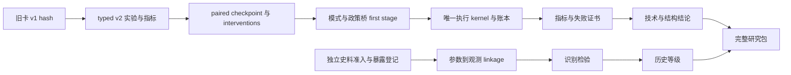

# M1–M11：执行路径、缺口与历史证据

**STOP：11/11 JSON 有效 ≠ 11/11 专用实验完成。** [VERIFIED_BY_RUN] 本轮 loader 验证11卡；每卡 minimum_replicates=3，五种 result_categories 均有；schema不验证每条自然语言指标的实际输出源。[VERIFIED_BY_CODE] `calibration/mechanism_cards.py:1–53` 是 schema/loader，不是实验或 verdict engine；旧结果不由此新增推断。

[REPORTED_ONLY] P06最终报告归类 M2/M3/M11 CONDITIONAL，其余 UNIDENTIFIED。保留其冻结语境；本轮不是逐卡重跑，不重新升级/降级原判决。[VERIFIED_BY_CODE] 六个行为先验无独立 linkage（p05.json:60–80）。历史 evidence_grade、technical_status、structural_status 必须三维保存。

## 完整因果/模块/资料映射

下表“新增”是 [HYPOTHESIS] 的下一版任务，既有路径和缺口为 [VERIFIED_BY_CODE]，特别实跑另标。每卡原始字段、hash、精确指标原文见文末机器导出的卡片快照。

| 卡 | 既有执行模块 / 指标源 | 缺口与新增最小任务 | 独立历史观测 / 识别依赖 | 决策 |
|---|---|---|---|---|
| M1 社会契约棘轮 | `household_welfare.py:214` 已更新 adaptive expectations；`opposition.py` grievance；`policy.py:74` welfare/import bridge | 原卡1961 vs1967等幅裁剪混入宏观状态差异；复用棘轮，在同季度匹配福利/现金/供给，改变可声明的过去改善史，保存event-study。消费/forced saving走预算表，grievance需政治scenario。 | 消费参照、同期情绪/请愿、福利政策记录；coalition、observation 未识别 | REVISE：拒绝新增平行棘轮与跨年份直接归因 |
| M2 SBC+投资短缺 | `finance.py:716` credit/bailout；`material.py` orders/investment；organization_diagnostics | hardness×investment demand 2×2；真实投入/安装/供给抢占。`commodity_circuit` 是 audit-leak sidecar而非C0标准表；将metric绑定执行后账户。 | 企业贷款、救助决定、投资申请/实物安装、投入流；原卡依赖[]不等于历史系数已识别 | ACCEPT机制方向，REVISE指标、需求路径与竞争机制 |
| M3 就业/劳动纪律 | 工资/欠薪、labor allocation、有效产出既有；household time/effort路径可复用 | 没有独立已声明的企业人员囤积观测；工资提高不是hoarding操作。新增编制/有效工时/缺勤/招聘释放状态须单独制度契约；总劳动不能无中生有。 | 企业编制、实际工时/出勤、欠薪和劳动生产率；原依赖[]仅说明未声明参数块 | REVISE：先劳动identity，再测充分就业假说 |
| M4 第二经济 | `second_economy.py:35,72` household time / settlement；plot收入与正式物资竞争已有 | [VERIFIED_BY_RUN] F2 second_input/output commodity tuples均为空；`network.py:304–313` 按P02旧IDs映射，settle:104提前返回。先新本体recipe与F2适配，测试工时/资金/投入品守恒，之后禁止/容忍/扩张×短缺实验。 | 家庭副业、附属地、时间/投入品、第二经济收入；culture 未识别 | REVISE：F2接线优先；复用模块，不建平行经济 |
| M5 1968自主性 | PoliticalSession→policy→material targets、finance/investment；autonomy已有 | 同1967Q4 checkpoint、autonomy×hardness 2×2；效率和失衡双指标；`money_stock`来自leak sidecar，不自动存在于标准run。操作路径/适配指标先冻结。 | 企业自主权条例、投资/生产率、采购信用记录；coalition、information 未识别 | ACCEPT共享企业链，REVISE测量与模式 |
| M6 外债平滑 | `trade.py:124` debt service与贷款；`material.py:1230` convertible_loan_limit；两渠道imports | 原卡 `convertible_credit_envelope` 无对应已声明参数，不能静默忽略；用正式loan limit/term typed intervention。原借款本金与利息arrears分账，不无条件资本化。新增外国债权人账及期限场景逐一核算。 | 外债存量、draw、利息、本金偿还、外汇、商品进口及期限；external_recipe 未识别 | REVISE：先闭合外贸账，消费改善只是中介 |
| M7 地区收益 | 20-region ontology；aggregates、household_budgets、opposition_regions | 原 manipulated investment_intensity/housing_factor是全国scalar，不是地区分配vector；新增全国预算/物资总额守恒的地区配额与边流adapter；地区住房存量与供给分开。 | 地区就业、住房、实物交付与地方不满；opposition、coalition 未识别 | REVISE：全国不变的空间实验 |
| M8 联盟与危机 | `politics.py` 候选决策；`political_run.py:1829` endogenous broker；selected candidate/policy_decisions | [VERIFIED_BY_RUN] replay Soviet fork policy delta=0，endogenous部分非零；不能以digest支持经济传导。用endogenous实质政策控制+replay负对照；危机→观测→联盟→policy→资源逐层trace。 | 会议实际决定/人事/政策时点，不止议程；coalition、observation、information 未识别 | REVISE：模式先验收；null合法且定位 |
| M9 信息与优化 | `technology.py:68–100`能力到信息维度；观测发布/滞后；PoliticalSession中央target已有 | forecast_accuracy=capability为定义；需要保存t时预测与t+k实测残差。信息质量×调度器2×2、相同真实状态冲击；优化器只读observed state，CPU预算/观察年龄独立。 | 原计划→初报→核定、版本修订、延迟；设备只是capacity辅助；information未识别 | REVISE：实际误差与计划执行缺口，非改定义分数 |
| M10 外部缓冲 | 1973臂、trade/loan/subsidy账、长期消费缺口 | P06旧臂只REPORTED_ONLY；拆成本/terms of trade/信用/补贴因素，控制相同外部路径；窗口截止1985，不越保留窗补看债务结果。 | 外贸价格数量、CMEA结算、贷款期限、财政补贴；external_recipe 未识别 | ACCEPT因子拆分，REVISE依赖P08D |
| M11 I/II竞争 | departments、investment安装、industrial priority、F2耐用品g13 | 旧F1 fork八商品不能直接取g13；实际产出路径是endogenous，不能强行固定产出再测试挤出。总外生资金/产能/需求匹配，实际产出作为结果，消费、等待、地区、物量同时出报表；I/II按用途区分。 | 部门IO、投资品用途、安装、耐用品交付/等待与储蓄；原依赖[]不代表无需IO资料 | REVISE：与M2/M5共享，可比fidelity冻结 |

## 指标与干预契约

[VERIFIED_BY_CODE] 当前 JSON 多含“x/y proxy”“later-window”“regional allocation via”等自由文本，无法自动证明字段存在。C0/C1 原始表 schema 已保存在 [directed-probe.json](evidence/directed-probe.json)。原 JSON不得原地删改；v2保存原SHA、supersedes、change_reason、preregistration时间与git_sha。

[HYPOTHESIS] `MetricSpec` 最少包括 table/sidecar、typed column、unit、fidelity、region/commodity selector、aggregation、time_window、missing_policy、data_role、comparison_grade。无表/零行/商品不在axis时 `BLOCKED_METRIC`，禁止填0；manipulation至少包括参数路径、操作时间、量级、可应用模式、实际值差；invalid path拒绝运行。three seeds只有对照/干预同checkpoint同RNG消费的paired运行才算有效设计。

[HYPOTHESIS] first-stage分层：loaded→state_delta→chosen_policy_delta→effective_parameter_delta→active_constraint_delta→flow_delta→metric_delta。每层保存零/非零和原因；非绑定约束导致null与干预未接线应不同状态。不能要求每层都非零后才允许有研究结果；真正null应出具反证，而未接线不能裁定经济假说。



[HYPOTHESIS] 上图是依赖设计；不能将尚未实现的 `experiments/measurement/evidence` 当成已有目录。已有 SocioVerse integration 包含真实 `LongitudinalSimulator` adapters 和 PoliticalSession 执行，不只是trace shell（`integrations/socioverse.py:277,312,450,595`，`tests/test_socioverse_p04.py`）。默认复用，不复制第二权威时钟/政府/银行状态。

[BLOCKED] 本轮未对11卡逐项运行完整专用研究设计；暂时合法blocked包可提供搜索范围、缺口与UNIDENTIFIED，但缺paired metrics/负对照/账本/重放的占位卡不能标 `research_package_complete`。

## v1 预注册字段快照（VERIFIED_BY_CODE，loader实测11/11）

### M1

源 `config/p06/cards/M1.json:1`，SHA `7a3beaa4be817cfb745a163c579b0ec472fcfb3f55c8caaca7db15854c74352d`。

```json
{
  "mechanism_id": "M1",
  "hypothesis": "consecutive consumption improvement raises the political cost of a later welfare/real-income cut nonlinearly, so an equal cut provokes a larger response after a long improvement run than early in the window.",
  "manipulated_variables": [
    "policy.welfare_provision one-shot cut of equal size applied at 1961Q1 vs 1967Q1",
    "policy.consumer_import_factor as a second real-income lever"
  ],
  "controlled_variables": [
    "external history and the intervention files",
    "seed",
    "the remaining policy vector"
  ],
  "metrics": [
    "household_consumption",
    "household_budgets.spending",
    "opposition_regions.weighted_grievance",
    "political_quarters.policy_welfare_provision",
    "forced_saving"
  ],
  "falsification_criterion": "the late cut's response in the grievance/consumption metrics is not larger than the early cut's by the declared margin.",
  "minimum_replicates": 3,
  "result_categories": [
    "SUPPORTED",
    "CONDITIONAL",
    "WEAK",
    "REJECTED",
    "UNIDENTIFIED"
  ],
  "calibrated_parameter_dependencies": [
    "p04_coalition_prior",
    "p04_observation_prior"
  ]
}
```

### M2

源 `config/p06/cards/M2.json:1`，SHA `0da621e51ad436103ec3c76d820701cda84e8bb0c9cb79ef0947337856990589`。

```json
{
  "mechanism_id": "M2",
  "hypothesis": "soft budget plus investment hunger is sufficient to sustain systemic shortage independently of the demand regime.",
  "manipulated_variables": [
    "policy.budget_hardness",
    "policy.credit_fraction",
    "bailout_envelope_fraction",
    "credit_envelope_fraction"
  ],
  "controlled_variables": [
    "demand shocks",
    "external history",
    "seed"
  ],
  "metrics": [
    "tick_diagnostics.bottleneck_demand_count",
    "aggregates.undelivered share",
    "organization_diagnostics.credit_drawn/shortage_expectation_mean",
    "commodity_circuit.stock_close"
  ],
  "falsification_criterion": "with hardness raised and credit cut, the shortage metrics do not fall.",
  "minimum_replicates": 3,
  "result_categories": [
    "SUPPORTED",
    "CONDITIONAL",
    "WEAK",
    "REJECTED",
    "UNIDENTIFIED"
  ],
  "calibrated_parameter_dependencies": []
}
```

### M3

源 `config/p06/cards/M3.json:1`，SHA `06adefbd144800d1ff2afd10f5f73765f6e70339d1280ba002b434bb6e32f8ba`。

```json
{
  "mechanism_id": "M3",
  "hypothesis": "full employment weakens enterprise discipline and feeds wage/hoarding feedback.",
  "manipulated_variables": [
    "policy.wage_factor",
    "policy.plan_utilization"
  ],
  "controlled_variables": [
    "output targets",
    "external history",
    "seed"
  ],
  "metrics": [
    "organization_diagnostics.labor_mean/wage_arrears_sum",
    "national_accounts.production per worker proxy",
    "aggregates.household_desired vs delivered"
  ],
  "falsification_criterion": "a wage-factor raise does not increase labour hoarding/arrears or reduce discipline metrics.",
  "minimum_replicates": 3,
  "result_categories": [
    "SUPPORTED",
    "CONDITIONAL",
    "WEAK",
    "REJECTED",
    "UNIDENTIFIED"
  ],
  "calibrated_parameter_dependencies": []
}
```

### M4

源 `config/p06/cards/M4.json:1`，SHA `c9e70e5ca07bca8e7865f274dc052cb1ed5aed795787a9a07f16ec37fb5323ac`。

```json
{
  "mechanism_id": "M4",
  "hypothesis": "the second economy is net stabilising or net eroding for the formal system.",
  "manipulated_variables": [
    "policy.second_economy_tolerance",
    "policy.private_autonomy"
  ],
  "controlled_variables": [
    "formal-sector parameters",
    "external history",
    "seed"
  ],
  "metrics": [
    "aggregates.plot_self_use/plot_market_sales",
    "household_budgets.plot_income_formal/plot_income_direct",
    "formal household_availability_unmet",
    "departments.service_use_household"
  ],
  "falsification_criterion": "tolerance changes move neither the household availability gap nor the formal sector's delivery metrics.",
  "minimum_replicates": 3,
  "result_categories": [
    "SUPPORTED",
    "CONDITIONAL",
    "WEAK",
    "REJECTED",
    "UNIDENTIFIED"
  ],
  "calibrated_parameter_dependencies": [
    "p04_culture_prior"
  ]
}
```

### M5

源 `config/p06/cards/M5.json:1`，SHA `cdcbbfbd8d99b8b0d55f1afeaf564d2fac5cef3cd53d7058f75943af611bd879`。

```json
{
  "mechanism_id": "M5",
  "hypothesis": "enterprise autonomy rising while soft-budget constraints persist produces efficiency gains and macro imbalance simultaneously.",
  "manipulated_variables": [
    "policy.enterprise_autonomy (the replayed 1968 patch is 0.7)",
    "separately policy.budget_hardness"
  ],
  "controlled_variables": [
    "external history",
    "seed",
    "the other coordinates"
  ],
  "metrics": [
    "organization_diagnostics.investment_approved/credit_drawn",
    "national_accounts.production/used",
    "tick_diagnostics.bottleneck_demand_count",
    "money_stock.money_total_close"
  ],
  "falsification_criterion": "autonomy raises do not change the efficiency proxy without also changing the imbalance proxy (or vice versa).",
  "minimum_replicates": 3,
  "result_categories": [
    "SUPPORTED",
    "CONDITIONAL",
    "WEAK",
    "REJECTED",
    "UNIDENTIFIED"
  ],
  "calibrated_parameter_dependencies": [
    "p04_coalition_prior",
    "p04_information_prior"
  ]
}
```

### M6

源 `config/p06/cards/M6.json:1`，SHA `047db0a8473f326c8a6a2609bc18ea42c24cb979a96f0a20cf254575dde5e6c6`。

```json
{
  "mechanism_id": "M6",
  "hypothesis": "external debt lengthens the social contract and shifts its cost forward.",
  "manipulated_variables": [
    "policy.borrowing_factor",
    "convertible_loan_limit",
    "convertible_credit_envelope"
  ],
  "controlled_variables": [
    "external demand",
    "seed",
    "domestic policy"
  ],
  "metrics": [
    "national_accounts.imports by channel",
    "money_stock (credit/principal)",
    "household_consumption",
    "treasury_cash"
  ],
  "falsification_criterion": "additional borrowing does not defer the consumption/treasury deterioration.",
  "minimum_replicates": 3,
  "result_categories": [
    "SUPPORTED",
    "CONDITIONAL",
    "WEAK",
    "REJECTED",
    "UNIDENTIFIED"
  ],
  "calibrated_parameter_dependencies": [
    "p04_external_recipe_prior"
  ]
}
```

### M7

源 `config/p06/cards/M7.json:1`，SHA `f6383c8b16fa5f16e2517ec992da2524a2ba1eb31612ff4c542515f3d3399d90`。

```json
{
  "mechanism_id": "M7",
  "hypothesis": "uneven distribution of social-contract gains across Budapest, the industrial belt and the agricultural counties creates different stability paths.",
  "manipulated_variables": [
    "regional allocation via policy.investment_intensity plus policy.housing_factor",
    "the 20 historical regions are the observation axis"
  ],
  "controlled_variables": [
    "national aggregates",
    "external history",
    "seed"
  ],
  "metrics": [
    "aggregates and household_budgets by region_id",
    "opposition_regions by region"
  ],
  "falsification_criterion": "regional dispersion of the delivery/consumption metrics does not respond to the regional allocation levers.",
  "minimum_replicates": 3,
  "result_categories": [
    "SUPPORTED",
    "CONDITIONAL",
    "WEAK",
    "REJECTED",
    "UNIDENTIFIED"
  ],
  "calibrated_parameter_dependencies": [
    "p04_opposition_prior",
    "p04_coalition_prior"
  ]
}
```

### M8

源 `config/p06/cards/M8.json:1`，SHA `f4761f7f7b3865e61d285ccdd058c91ee0cfd463964cb2b7c4b6f03e22dd0bd1`。

```json
{
  "mechanism_id": "M8",
  "hypothesis": "economic deterioration strengthens administrative conservatism under some conditions and the reform coalition under others.",
  "manipulated_variables": [
    "the fork's coalition_weights and the reported feature path (via the 1968 arms)"
  ],
  "controlled_variables": [
    "external history",
    "seed"
  ],
  "metrics": [
    "political_quarters mode weights and selected_candidate",
    "policy_decisions.utility"
  ],
  "falsification_criterion": "coalition weights do not switch modes under the declared deterioration path.",
  "minimum_replicates": 3,
  "result_categories": [
    "SUPPORTED",
    "CONDITIONAL",
    "WEAK",
    "REJECTED",
    "UNIDENTIFIED"
  ],
  "calibrated_parameter_dependencies": [
    "p04_coalition_prior",
    "p04_observation_prior",
    "p04_information_prior"
  ]
}
```

### M9

源 `config/p06/cards/M9.json:1`，SHA `fa1b30703cda0009471e03cdf6b88b47d20a7ce525385adfdd554f595e55273c`。

```json
{
  "mechanism_id": "M9",
  "hypothesis": "stronger statistical/computational/feedback capacity removes a measurable share of shortage and planning error.",
  "manipulated_variables": [
    "technology.capability (one-shot)",
    "policy.information_investment (the digital-nem arm)"
  ],
  "controlled_variables": [
    "the replayed policy path",
    "external history",
    "seed"
  ],
  "metrics": [
    "information_quarters.data_latency/measurement_error/forecast_accuracy/optimization_capacity",
    "policy_decisions.binding_constraints",
    "tick_diagnostics.bottleneck_demand_count"
  ],
  "falsification_criterion": "capability/investment raises do not reduce latency/error or the shortage metrics.",
  "minimum_replicates": 3,
  "result_categories": [
    "SUPPORTED",
    "CONDITIONAL",
    "WEAK",
    "REJECTED",
    "UNIDENTIFIED"
  ],
  "calibrated_parameter_dependencies": [
    "p04_information_prior"
  ]
}
```

### M10

源 `config/p06/cards/M10.json:1`，SHA `c23d545b59432e6f9412c512824aba5af40cc242daaa4c65239c6f4ae129b880`。

```json
{
  "mechanism_id": "M10",
  "hypothesis": "subsidies, borrowing and CMEA terms postpone an external shock, and the postponement raises later fragility.",
  "manipulated_variables": [
    "the 1973 arms in Annex B"
  ],
  "controlled_variables": [
    "seed",
    "the pre-1973 path"
  ],
  "metrics": [
    "national_accounts.imports/exports by channel",
    "money_stock.money_total_close",
    "treasury_cash",
    "later-window aggregates.household_availability_unmet"
  ],
  "falsification_criterion": "the absorption arms do not differ in the size or timing of the postponement.",
  "minimum_replicates": 3,
  "result_categories": [
    "SUPPORTED",
    "CONDITIONAL",
    "WEAK",
    "REJECTED",
    "UNIDENTIFIED"
  ],
  "calibrated_parameter_dependencies": [
    "p04_external_recipe_prior"
  ]
}
```

### M11

源 `config/p06/cards/M11.json:1`，SHA `c65318dc1d4c149d7d15b49db229c19768a282f5e6c59307197fe194d1c86887`。

```json
{
  "mechanism_id": "M11",
  "hypothesis": "continued investment and input priority for Department I crowds out Department II through raw-material, capital-good and labour competition, raising assortment shortage, durable waiting, forced substitution and the social-contract gap even when aggregate output grows.",
  "manipulated_variables": [
    "policy.investment_intensity",
    "policy.industrial_priority"
  ],
  "controlled_variables": [
    "aggregate output path",
    "external history",
    "seed"
  ],
  "metrics": [
    "aggregate consumer-goods volume (national_accounts.household_consumption)",
    "assortment/availability (aggregates.household_availability_unmet, tick_diagnostics.bottleneck_demand_count)",
    "regional distribution (by region_id)",
    "durable waiting (aggregates.household_desired vs delivered for g13_household_durables)",
    "household welfare loss (household_budgets saving/substitution columns)",
    "departments.actual_use_value split by department"
  ],
  "falsification_criterion": "raising I-priority does not shift the department split or worsen the four consumer-side dimensions while output is held up.",
  "minimum_replicates": 3,
  "result_categories": [
    "SUPPORTED",
    "CONDITIONAL",
    "WEAK",
    "REJECTED",
    "UNIDENTIFIED"
  ],
  "calibrated_parameter_dependencies": []
}
```
